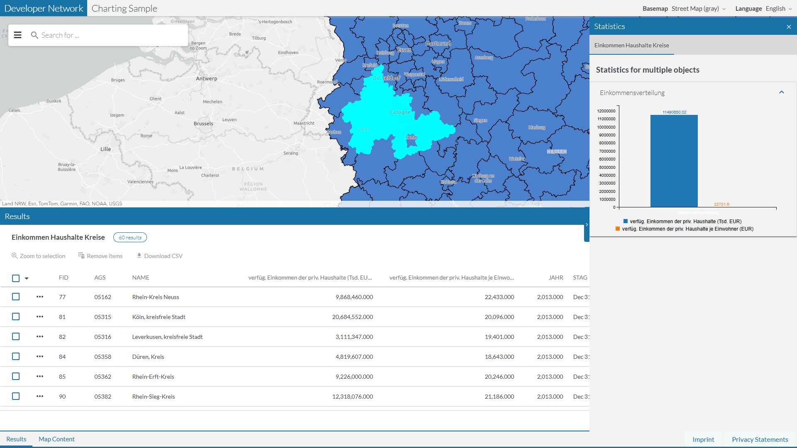

[](https://github.com/conterra/mapapps-charting/actions/workflows/devnet-bundle-snapshot.yml)


# Charting

The Charting Bundle allows you to display various charts based on data from an AGSSearch store.
By selecting one or more features from the selection-ui bundle, you can trigger the drawing of these charts.
You can choose of a variety of different chart types like: bar, line, spline, area and donut.



## Sample App
https://demos.conterra.de/mapapps/resources/apps/public_demo_charting/index.html?

[dn_charting Documentation](https://github.com/conterra/mapapps-charting/tree/master/src/main/js/bundles/dn_charting)

## Quick start

Clone this project and ensure that you have all required dependencies installed correctly (see [Documentation](https://docs.conterra.de/en/mapapps/latest/developersguide/getting-started/set-up-development-environment.html)).

Then run the following commands from the project root directory to start a local development server:

```bash
# install all required node modules
$ mvn initialize

# start dev server
$ mvn compile -Denv=dev -Pinclude-mapapps-deps

# run unit tests
$ mvn test -P run-js-tests,include-mapapps-deps
```

## License

This project is licensed under the [Apache License 2.0](LICENSE).

### Third-party software

The following third-party software is compiled into the bundles of this project and distributed with them:

| Component | Used in bundle | License |
|---|---|---|
| [c3](https://c3js.org/) 0.7.20 | `dn_charting` | MIT, Copyright (c) 2013 Masayuki Tanaka |
| [d3](https://d3js.org/) 5.16.0 (dependency of c3) | `dn_charting` | BSD-3-Clause, Copyright 2010-2017 Mike Bostock |
| d3 modules (dependencies of d3): d3-array 1.2.4, d3-axis 1.0.12, d3-brush 1.1.6, d3-chord 1.0.6, d3-collection 1.0.7, d3-color 1.4.1, d3-contour 1.3.2, d3-dispatch 1.0.6, d3-drag 1.2.5, d3-dsv 1.2.0, d3-ease 1.0.7, d3-fetch 1.2.0, d3-force 1.2.1, d3-format 1.4.5, d3-geo 1.12.1, d3-hierarchy 1.1.9, d3-interpolate 1.4.0, d3-path 1.0.9, d3-polygon 1.0.6, d3-quadtree 1.0.7, d3-random 1.1.2, d3-scale 2.2.2, d3-scale-chromatic 1.5.0, d3-selection 1.4.2, d3-shape 1.3.7, d3-time 1.1.0, d3-time-format 2.3.0, d3-timer 1.0.10, d3-transition 1.3.2, d3-voronoi 1.1.4, d3-zoom 1.8.3 | `dn_charting` | BSD-3-Clause, Copyright Mike Bostock |

The license texts are shipped with the bundles in `licenses/<component>/`.
